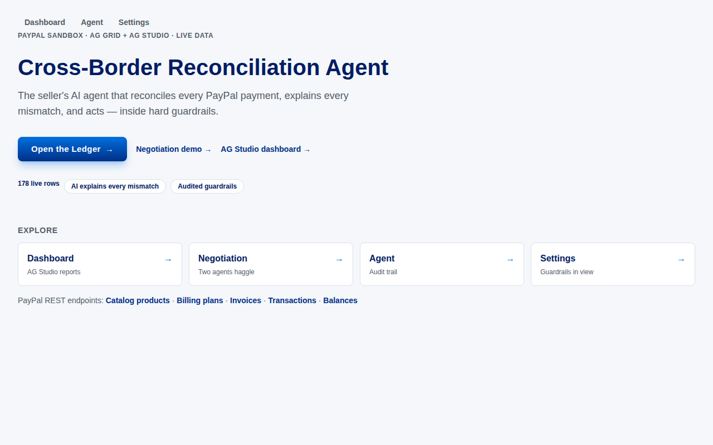
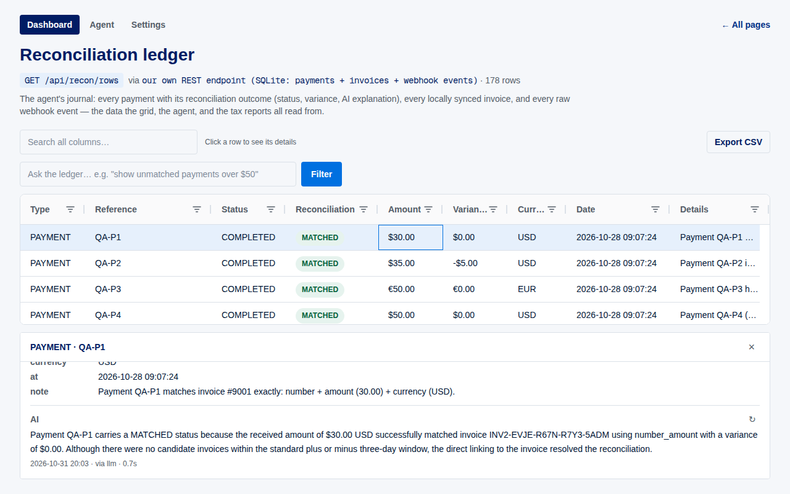
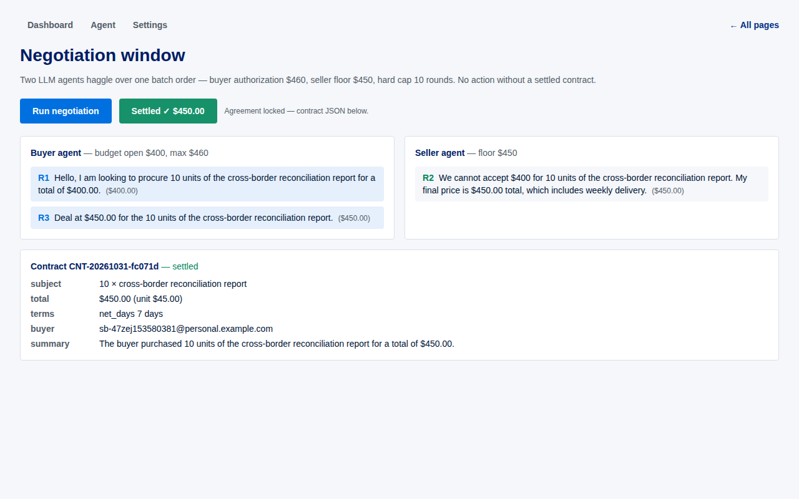
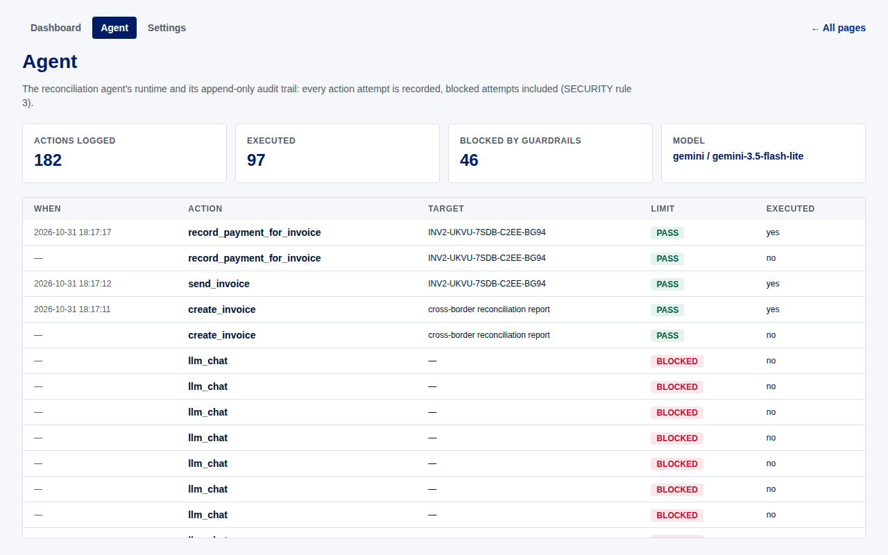
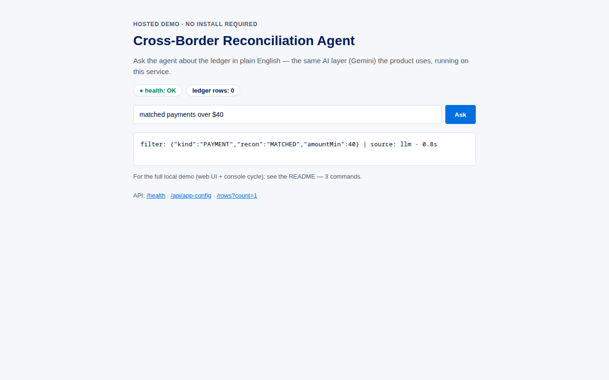

# PayPal Reconciliation Agent

Cross-border reconciliation agent for small merchants and freelancers: an AI
agent that classifies incoming PayPal payments, reconciles them against
invoices, drafts reminders, explains mismatches, and acts — with hard
guardrails (amount limits, rate limits, human approval for irreversible
actions, full action logging).

Built for the [PayPal AI Hackathon](https://paypalaihackathon.devpost.com/)
(deadline Nov 12, 2026).

**Who it's for:** freelancers and international sellers who get paid via PayPal
across borders — every mismatch costs an hour of manual work, or a chargeback.

## Demo video (1:41)

▶ **[Watch on YouTube](https://youtu.be/7WFiknEULyU)** — the problem, the product,
a live end-to-end sandbox cycle (negotiate → invoice → pay → reconcile → explain),
and the hosted browser demo. English voiceover with burned-in subtitles.

## Screenshots

**Home — what it is, one screen:**


**The Ledger — live rows, status pills, AI-explained decision (`via llm`):**


**Negotiation — two agents settle into a validated contract:**


**Agent — append-only audit trail, guardrail refusals included:**


**Hosted demo — no install, same AI layer, from any browser:**


## How AI is used

**Model.** Gemini (`gemini-3.5-flash-lite` by default) behind a thin
provider-agnostic layer — `LLM_PROVIDER`, `LLM_MODEL`, `LLM_API_KEY` in
`.env.local`. Every AI call runs under a **14 s budget** and falls back to
deterministic rules, so a slow or missing model never blocks the product.

**Tools.** PayPal access goes through the
[PayPal Agent Toolkit](https://github.com/paypal/agent-toolkit):
`create_invoice`, `send_invoice`, `get_invoice`, `list_invoices`,
`record_payment_for_invoice`, `send_invoice_reminder` (plus read-only
transactions/disputes lookups). Destructive operations — cancel, delete, refund,
accepting a dispute — are on the **red list: human-only, never exposed to the agent**.

**The chain — where the model actually runs:**

1. **Plain English → filter** (`/api/nl-filter`): *"show unmatched payments over $50"*
   → validated filter JSON → grid. Slow or absent LLM → deterministic keyword parser.
2. **Row explanations** (`/api/explain`): the insight in the detail panel, with the
   source labeled in the UI — `via llm · 0.7s` or `via fallback · …`.
3. **Negotiation**: two LLM agents (buyer vs. seller) exchange messages inside hard
   budgets and a round cap **the model itself cannot exceed** → agreement → validated
   contract JSON → invoice through a tool call.
4. **Actions**: tool call → guardrail policy (`enforceActionPolicy`: amount limit,
   rate limits, allowed operation) → PayPal API → append-only audit trail (blocked
   attempts are logged too — see the **Agent** screen).

## PayPal APIs used

Everything runs against PayPal's **sandbox** (`api-m.sandbox.paypal.com`,
client-credentials OAuth). Two surfaces call it: the agent backend through the
PayPal Agent Toolkit (`src/paypal.ts`) and the UI pages through a thin REST client
(`web/lib/paypal.ts`).

| Capability (REST) | What this project does with it |
|---|---|
| **Invoicing** `/v2/invoicing/invoices` | the core cycle: create draft → send → get/list → **record external payment** → send/automatic reminders; invoice numbers generated by PayPal |
| **Webhooks** `POST /webhook` | every sandbox event lands in `webhook_events` — **16 types observed end-to-end** (`INVOICING.INVOICE.CREATED/SENT/PAID/UPDATED/REFUNDED/UNPAID/CANCELLED`, `PAYMENT.CAPTURE.*`, `CUSTOMER.DISPUTE.*`); `INVOICING.INVOICE.PAID` materialises the payments row the ledger reconciles |
| **Reporting — transactions** `/v1/reporting/transactions` | date-bounded transaction search (`fields=all`) behind the Transactions page |
| **Reporting — balances** `/v1/reporting/balances` | per-currency total / available / withheld behind the Balances page |
| **Catalog** `/v1/catalogs/products` | seller catalog, read live (list + fetch-by-id) behind the Products page |
| **Billing plans** `/v1/billing/plans` | subscription plans, read live behind the Billing plans page |
| **Orders** (create / get / capture) | wired in the toolkit config; `pay_order` is part of the dry-run vocabulary |
| **Disputes** (list / get — read-only) | wired read-only; **accepting a dispute is human-only (red list)** |

Agent-side tool calls (see «How AI is used»): `create_invoice`, `send_invoice`,
`get_invoice`, `list_invoices`, `record_payment_for_invoice`, `send_invoice_reminder`.

## Quick start — 3 commands on a fresh machine

```bash
git clone https://github.com/koztechie/paypal-recon-agent.git
cd paypal-recon-agent && npm install && cp .env.example .env.local
npm run demo
```

**No keys, no side effects:** the demo runs the full story end-to-end —
two LLM agents negotiate a price → contract JSON → invoice → payment →
confirmations to **both** agents — in **dry-run mode** (~30 s), ending with
`PROVEN (simulated: dry-run mode)`. Money actions are intercepted and logged to
`logs/dryrun.ndjson`; with an unfilled `LLM_API_KEY` the negotiation uses its
built-in deterministic fallback.

**Want the real thing?** Fill `.env.local` (PayPal sandbox credentials from
<https://developer.paypal.com/developer/applications/> + a Gemini `LLM_API_KEY`),
set `DRY_RUN='false'` — the same `npm run demo` then runs the **real sandbox cycle**
(create → send → pay → reconcile), and the web UI becomes fully populated.

**Requirements:** Node ≥ 22.18 (`engines`), npm.

## Run the web UI (optional, for the interactive demo)

```bash
npm run dev          # agent API on :3000
cd web && npm install && npm run start   # UI on http://localhost:3001
```

Open <http://localhost:3001> — homepage → **Open the Ledger** (live grid with
filters, AI explanations, row actions, NL queries), **Negotiation demo** window,
**Agent** audit trail, **Settings**.

## Hosted service (no install)

- Health: <https://paypal-recon-agent.onrender.com/health> → `200`
- The book is **self-healing**: an empty database is restored at boot from the
  committed sanitized snapshot (`seed/book-snapshot.json`), so deploys never lose
  the demo data.
  (free instance sleeps — the first hit may take ~50 s).
- Public API (keyless demo surfaces): `/api/nl-filter` (ask in plain English),
  `/api/explain` (row explanations), `/api/app-config` (runtime config, no secrets).
  The state-changing endpoints — `/api/action`, `/api/recon/run`, `/api/negotiate` —
  require `Authorization: Bearer $ACTION_TOKEN` in production (see SECURITY.md).
- Logs: Render dashboard → **Logs** tab; locally `logs/webhooks.ndjson` and friends.

## Troubleshooting — 5 common startup errors

**1. Server won't answer: `curl localhost:3000/health` → `000` / `EADDRINUSE`.**
The dev process died (a `--watch` crash prints the reason above the shell) or
another process holds the port.
*Fix:* look at the `npm run dev` output for the stack trace; then free the port and
restart:
```bash
lsof -ti :3000 | xargs -r kill     # Windows: netstat -ano | findstr :3000
npm run dev                        # expect: [server] listening on http://localhost:3000
```

**2. Local webhook events never arrive; the tunnel page shows `ERR_NGROK_3200
(endpoint is offline)`.**
The ngrok process died — PayPal's sandbox events are lost for local development
(the hosted service is unaffected).
*Fix:* restart the tunnel and verify it answers, then re-trigger your event:
```bash
ngrok start ecwid-dev
curl -s -o /dev/null -w "%{http_code}\n" https://<your-subdomain>.ngrok-free.dev/health   # expect 200
```

**3. Hosted service looks dead on first contact (Render free plan).**
Symptoms: the first request takes up to ~50 s or returns an empty body, and the
Logs tab starts with `.env.local not found. Continuing without it.`
*Fix:* none needed — the instance sleeps with inactivity (warm it with one request:
open `https://paypal-recon-agent.onrender.com/health`), and the `.env.local` line is
**benign by design** — on Render the secrets come from Environment variables, and the
start script deliberately skips a missing local file.

**4. `PAYPAL_CLIENT_ID is missing (see .env.example)` (or PayPal auth fails silently).**
The `.env.local` file is absent, still has `REPLACE…` placeholders, or values were
copied **together with the surrounding single quotes** (quotes belong to the file
syntax only — pasted into Render/other tools they break auth without a clear error).
*Fix:* `cp .env.example .env.local`, paste each value **between** the quotes, restart.
Remember `DRY_RUN='true'` runs everything without credentials at all.

**5. An answer is slow or says `via fallback` instead of `via llm`.**
The Gemini free tier is queued at peak times; the product treats the LLM as optional:
NL queries, explanations and negotiation all fall back to deterministic rules after
~14 s, so nothing ever blocks — the UI labels the source (`via fallback · …`).
*Fix:* retry in a quieter minute, or probe current latency in one command:
```bash
node scripts/stage71-probe.mjs     # prints per-action ms + median (needs LLM_API_KEY)
```

## Stack

- TypeScript + Node.js backend (zero runtime deps beyond the PayPal toolkit)
- [PayPal Agent Toolkit](https://github.com/paypal/agent-toolkit) (sandbox)
- Gemini API (agent LLM layer, provider-agnostic via env vars; deterministic
  fallbacks everywhere — a slow/absent LLM never blocks the product)
- React + AG Grid / AG Studio frontend (`web/`)
- SQLite storage (`node:sqlite`), Render hosting

## Security

See [SECURITY.md](./SECURITY.md) — agent guardrails: amount limits,
human approval for irreversible actions, full action logging, rate limits,
secrets isolation (`.env.local` is git-ignored; never committed — verified
against the full git history).

## License

[MIT](./LICENSE)
